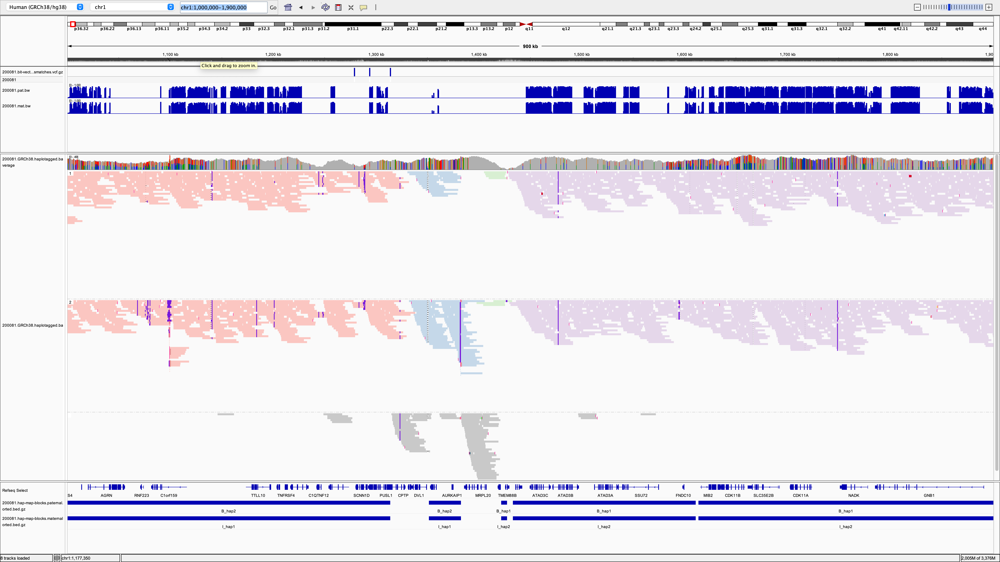
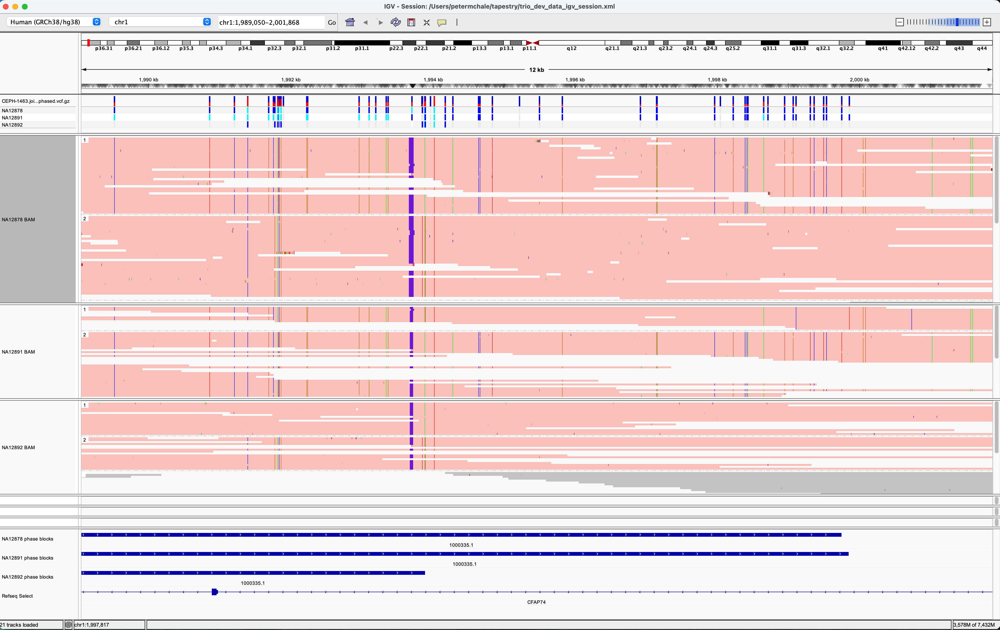
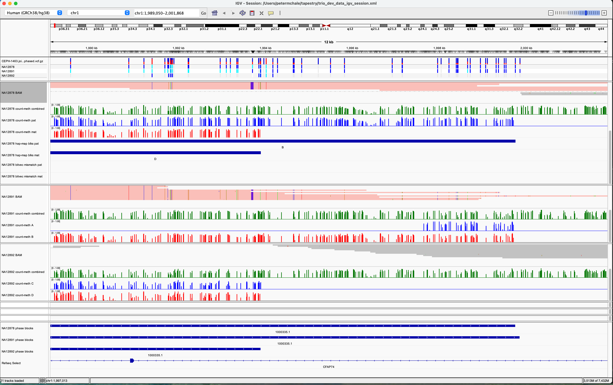
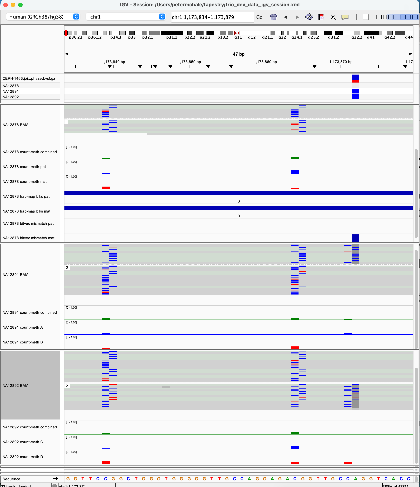

# tapestry

Phase DNA methylation from PacBio HiFi reads onto founder haplotypes in a human
pedigree, including trios. For BAM-based trio inputs, use the
[Nextflow trio workflow](#nextflow-trio-model-methylation-workflow); both workflows
use the same default Docker image.

## Generic WDL-output workflow

Run Tapestry on completed miniwdl outputs from the PacBio HiFi human WGS
`family` WDL **v3.3.0 or v3.3.1**, a six-column PED, and an indexed **GRCh38**
FASTA. This Nextflow workflow uses the WDL's HiPhase and model methylation
outputs; it processes `chr1`–`chr22` and selects PED members with both parents
present by default.

```bash
nextflow run . -profile slurm,apptainer \
  --outputs-json /path/to/miniwdl-run/outputs.json \
  --ped /path/to/family.ped \
  --reference-fasta /path/to/GRCh38.fa \
  --outdir /path/to/tapestry-results \
  -resume
```

Use `-profile docker` for local Docker runs. The [Dockerfile](Dockerfile)
pins runtime dependencies. Both container profiles use the published
`ghcr.io/quinlan-lab/tapestry:dev` image, which supports trio and pedigree runs.
Use `--container <image-or-digest>` to pin a run to a specific image; Apptainer
also accepts a local SIF. Configure site-specific queues and resources through a
local profile; see [nextflow.config](nextflow.config).
Docker tasks run with the launching user's UID/GID so output and work
directories remain writable and removable by that user.

### Options and validation

| Option | Default / purpose |
|---|---|
| `--samples CHILD1,CHILD2` | All PED members with both parents present |
| `--regions chr1,chr2` | All GRCh38 autosomes |
| `--reference-index PATH` | `<reference-fasta>.fai` |
| `--min-coverage` | `10` |
| `--mismatch-window-bp` | `50` |
| `--bigwig false` | Disable BigWigs; enabled by default |
| `--map-min-qual`, `--map-min-depth`, `--min-run-markers` | `20`, `10`, `10` |
| `--concordance-min-qual`, `--concordance-min-depth` | `20`, `5` |
| `--qc-discordance-threshold`, `--qc-min-paired-cpgs` | `0.4`, `100` |

Every run validates inputs first, checking the PED, sample sets, WDL release,
reference, artifact headers/indexes, and output collisions. Add `-entry validate`
to the same command for an optional preflight. Effective settings are printed
and saved in `pipeline_info/resolved-run.json`; canonical inputs and the
validation report are saved alongside it. No intermediate manifest is required
from the user.

### Results

Under `--outdir`, Tapestry writes:

- `samples/`: per-sample all-CpG BEDs, indexes, BigWigs, and QC.
- `reference/` and `inheritance/`: reference CpGs and inheritance-phasing outputs.
- `visualizations/`: offline haplotype ancestry and transmission QC views.
- `pipeline_info/`: validated inputs, settings, and provenance.
- `results-manifest.json`: published relative paths, indexes, and sample statuses.

The generic workflow uses model methylation only; count mode is disabled.
Completion prints the manifest path and sample status counts. Nextflow execution
reports go to `.nextflow-reports/` in the launch directory; `-with-*` options
can redirect them. Processing is chromosome-wise to bound memory. BigWigs
collapse repeated intervals only when their non-null values agree; conflicts fail.

### Explore ancestry and transmission QC

Open `<outdir>/visualizations/haplotype-ancestry/index.html` locally. Select a
sample and click an inheritance block to trace its founder haplotype through the
pedigree and compare mean methylation on the two haplotypes. Hover for counts
and QC details. Blank spans indicate missing inheritance blocks;
`inheritance map only` indicates no downstream methylation output. Neither
label describes sequencing coverage. Copy the entire `haplotype-ancestry/`
directory to move the offline visualization.

The **Transmission QC** link compares parent–child methylation, separating
completeness from concordance. Select both members for downstream processing to
obtain a concordance estimate. Click a pair for chromosome details and hover for
metrics and excluded-CpG counts. Colors show cohort-relative outlier severity;
scores stay blank when fewer than four pairs are available.

CpGs are paired by exact coordinates and matching transmitted founder labels,
excluding mismatch windows and ambiguous labels or values. Callable fraction
uses label-matched CpGs after exclusions as its denominator; inherited
specificity additionally requires a measurement on the parent's non-transmitted
haplotype. Ambiguous coordinates remain in shared-CpG counts but are excluded
from eligible and paired counts. These comparisons alone do not establish
inheritance of methylation state.

## Legacy shell workflows

These scripts use site-specific paths and tool installations. For completed WDL
outputs, use the Nextflow workflow above.

### Dependencies

The generic workflow obtains its tools from the configured container. The
legacy shell workflows below assume the following command-line tools are in the
user's PATH:

* `bgzip`, `tabix`, `bcftools`
* `gtg-ped-map`, `gtg-concordance` (https://github.com/Platinum-Pedigree-Consortium/Platinum-Pedigree-Inheritance/blob/e12aca6b49ee7208952467db4a2a9e2f79b98efb/HAPLOTYPING.md)
* `hiphase` (https://github.com/PacificBiosciences/HiPhase)
* `aligned_bam_to_cpg_scores` (https://github.com/PacificBiosciences/pb-CpG-tools)

### Installation

Install the python dependencies:

```
/path/to/python3.11 -m venv .venv
source .venv/bin/activate

# https://github.com/brentp/cyvcf2?tab=readme-ov-file#github-building-htslib-and-cyvcf2-from-source
cd $HOME
git clone --recursive https://github.com/brentp/cyvcf2
cd cyvcf2
pip install -r requirements.txt
CYVCF2_HTSLIB_MODE=EXTERNAL python setup.py install

cd /path/to/tapestry
pip install -r requirements.txt
```

Install `bedGraphToBigWig` into the virtual environment's bin directory:

```
# Choose the binary for your platform from the official UCSC downloads. Linux
# x86_64 example:
curl -O https://hgdownload.soe.ucsc.edu/admin/exe/linux.x86_64/bedGraphToBigWig
chmod +x bedGraphToBigWig
mv bedGraphToBigWig .venv/bin/
```

## Pedigree-wise workflow 

1. Phase variants:
   - Phase variants using read-backed phasing with the `run-hiphase.sh` script.
   - Build an inheritance-based haplotype map and inheritance-phase variants using the `build-iht-based-haplotype-map-and-phase-variants.sh` script.
2. Use `aligned_bam_to_cpg_scores.sh` to generate count- and model-based methylation levels from the haplotagged BAM files produced in step 1.
3. Phase count- and model-based methylation data to founder haplotypes using the `phase_meth_to_founder_haps.sh` script, which uses the data produced in steps 1 and 2.
4. Use `expand_to_all_cpgs.sh` script to generalize tapestry's output to include all CpG sites in the reference and sample genome, and unphased count- and model-based methylation levels, where available. This step also uses heterozygous SNVs to flag CpG sites that are "allele-specific", i.e., exist in only one of the haplotypes in the sample in question. Uses output of steps 2 and 3.

### Step 3 of pedigree workflow: Phasing count- and model-based DNA methylation to founder haplotypes 

The `phase_meth_to_founder_haps.sh` script calls a CL tool called `src/phase_meth_to_founder_haps.py`: 

```
vcf_read_phased="${read_phased_dir}/${uid}.GRCh38.deepvariant.glnexus.phased.vcf.gz" # single-sample vcf from hiphase
tsv_read_phase_blocks="${read_phased_dir}/${uid}.GRCh38.hiphase.blocks.tsv" # single-sample tsv from hiphase
vcf_iht_phased="${iht_phased_dir}/CEPH1463.GRCh38.pass.sorted.vcf.gz" # joint-called multi-sample vcf from gtg-ped-map/gtg-concordance
txt_iht_blocks="${iht_phased_dir}/CEPH1463.GRCh38.iht.sorted.txt" # multi-sample iht blocks file from gtg-ped-map/gtg-concordance
bed_meth_count_hap1="${meth_count_read_phased_dir}/${uid}.GRCh38.haplotagged.hap1.bed.gz" # bed file of count-based methylation from aligned_bam_to_cpg_scores for hap1
bed_meth_count_hap2="${meth_count_read_phased_dir}/${uid}.GRCh38.haplotagged.hap2.bed.gz" # bed file of count-based methylation from aligned_bam_to_cpg_scores for hap2
bed_meth_model_hap1="${meth_model_read_phased_dir}/${uid}.GRCh38.haplotagged.hap1.bed.gz" # bed file of model-based methylation from aligned_bam_to_cpg_scores for hap1
bed_meth_model_hap2="${meth_model_read_phased_dir}/${uid}.GRCh38.haplotagged.hap2.bed.gz" # bed file of model-based methylation from aligned_bam_to_cpg_scores for hap2
regions="chr1,chr2,chr3,chr4,chr5,chr6,chr7,chr8,chr9,chr10,chr11,chr12,chr13,chr14,chr15,chr16,chr17,chr18,chr19,chr20,chr21,chr22"

nohup python src/phase_meth_to_founder_haps.py \
    --uid ${uid} \
    --vcf_read_phased ${vcf_read_phased} \
    --tsv_read_phase_blocks ${tsv_read_phase_blocks} \
    --vcf_iht_phased ${vcf_iht_phased} \
    --txt_iht_blocks ${txt_iht_blocks} \
    --bed_meth_count_hap1 ${bed_meth_count_hap1} \
    --bed_meth_count_hap2 ${bed_meth_count_hap2} \
    --bed_meth_model_hap1 ${bed_meth_model_hap1} \
    --bed_meth_model_hap2 ${bed_meth_model_hap2} \
    --regions ${regions} \
    --output_dir ${output_dir} \
    > ${output_dir}/${uid}.log 2>&1 &

```

The tool writes founder-phased methylation, haplotype maps, mismatch sites, and
BigWigs for visualization in IGV:



### Step 4 of pedigree workflow: Expanding the dataset to include all CpG sites in the reference and the sample genome, and to include unphased DNA methylation, and to flag CpGs as "allele-specific" 

We would like to be aware of the existence of all CpG sites in the reference genome, irrespective of whether phased or unphased methylation levels are reported for those sites. Additionally, DNA methylation levels are computed at all CpG sites in the sample's haplotypes, even if those CpG sites are not in the reference genome (an example of a variant "creating" a CpG site in the sample). Conversely, CpG sites can be destroyed by mutation, and therefore a methylation level is not reported at that site on the corresponding haplotype. We call such CpG sites "allele-specific". Finally, this step of the workflow reports various QC statistics, e.g., the percentage of CpG sites (in reference and sample genomes, and on phasable chromosomes) at which count-based methylation is phased to at least one parental haplotype. See `https://github.com/quinlan-lab/tapestry/blob/main/src/expand_to_all_cpgs.200081.ipynb` for examples of all these things. 

### Output format of pedigree workflow

The BED header records the script and arguments in `##source=` and lists column
names on the final `#chrom` line. BED coordinates are zero-based, half-open.

Definitions of column headings: 

Column | Definition 
:--- | :---
chrom | chromosome on which CpG site is found 
start_cpg | start coordinate of CpG dinucleotide 
end_cpg | end coordinate of CpG dinucleotide 
total_read_count | total number of HiFi reads overlapping CpG site
methylation_level_count | methylation level: fraction of reads that are methylated (inferred from sequencing kinetics) at given CpG site, c.f., https://github.com/PacificBiosciences/pb-CpG-tools?tab=readme-ov-file#output-modes-and-option-details
methylation_level_model | methylation level: neural network maps sequencing kinetics at multiple CpG sites to methylation probability at a central CpG site, c.f., "Methods" section of https://www.pacb.com/wp-content/uploads/poster_saunders.pdf
start_hap_map_block | start of hap-map block (a genomic interval in which parental phasing of reads can be performed)
end_hap_map_block | end of hap-map block 
haplotype_concordance_in_hap_map_block | the degree of similarity (on a scale of 0 to 1, with 1 representing perfect similarity) of the bit vectors: sequences of alleles observed at heterozygous sites on haplotypes inferred by read-backed vs inheritance-backed phasing 
num_het_SNVs_in_hap_map_block | number of heterozygous sites in the given hap-map block 
total_read_count_pat | number of reads from the (deduced) paternal haplotype    
total_read_count_mat | number of reads from the (deduced) maternal haplotype
founder_haplotype_pat | a label indicating which of the haplotypes in a founder of the pedigree the paternal haplotype in the given individual was descended from 
founder_haplotype_mat | a similar label corresponding to the maternal haplotype of the sample 
methylation_level_pat_count | count-based methylation level on the paternal haplotype (fraction of paternal reads that are methylated)      
methylation_level_mat_count | count-based methylation level on the maternal haplotype (fraction of maternal reads that are methylated)          
methylation_level_pat_model | model-based methylation level on the paternal haplotype (deep-learning estimated methylation using only the paternal reads)     
methylation_level_mat_model | model-based methylation level on the maternal haplotype (deep-learning estimated methylation using only the maternal reads) 
cpg_is_within_50bp_of_mismatch_site | is the given CpG site within 50bp of a heterozygous site at which the read-based and inheritance-based bit vectors (allele sequences corresponding to each haplotype) are mismatched 
cpg_overlaps_at_least_one_snv | does the CpG dinucleotide overlap an SNV? 
snv_genotypes | are the SNVs (if any) that overlap CpG dinucleotide `hom` or `het`? 
cpg_is_allele_specific | does the CpG dinucleotide appear in the reads corresponding to one haplotype, but not the reads of the other haplotype? 

## Trio-wise workflow

### Nextflow trio model methylation workflow

Use `-entry trio` to run WhatsHap pedMEC, screen inferred crossovers by distance,
match child and parent bit vectors, haplotag BAMs, call model methylation, and
expand to all CpGs once per requested chromosome.
Use a six-column PED with one trio record
and three indexed BAMs whose read-group `SM` tags match the PED sample IDs.
The joint VCF must be bgzipped with a colocated `.csi` or `.tbi`. Keep BAM
indexes (`.bai` or `.csi`) beside the
BAMs and the FASTA's `.fai` beside the reference. A BGZF FASTA also needs its
`.gzi`.

The default image contains WhatsHap 2.8, samtools 1.21, pb-CpG-tools v3.0.0
(`aligned_bam_to_cpg_scores`), and all pedigree dependencies. Run with
`-entry trio -profile docker`; no build or image override is required.
Nextflow runs on the host. Docker pulls the image automatically, or pull it once:

```bash
docker pull --platform linux/amd64 ghcr.io/quinlan-lab/tapestry:dev
```

Published image tags:

| Tag | Contents / purpose |
|---|---|
| `dev` | Default trio-capable runtime for both workflows |
| `sha-<full-git-commit>` | Trio-capable runtime from a tested source revision |
| `pedigree-dev` | Smaller pedigree-only runtime without WhatsHap or pb-CpG-tools |
| `pedigree-sha-<full-git-commit>` | Pedigree-only runtime from that source revision |

Images are published to [GHCR](https://github.com/orgs/quinlan-lab/packages/container/package/tapestry)
only after CI checks pass on a main-branch push or a manual CI run. Published
SHA-256 digests are recorded in the publishing job summary. For reproducible
runs, supply `--container ghcr.io/quinlan-lab/tapestry@sha256:<digest>`;
`dev` is a moving development tag, not a stable release.

All images target Linux amd64; Docker on Apple Silicon requires amd64 emulation.
Tool archives are SHA-256 checked; Python additions are pinned in
[`requirements-trio.txt`](requirements-trio.txt). To build locally, use
`docker build --platform linux/amd64 -t tapestry:dev .` and pass
`--container tapestry:dev`. Building the smaller image is optional:
`docker build --platform linux/amd64 --target pedigree -t tapestry:pedigree .`.
The `trio` build target remains an alias for the full runtime.

For Slurm/Apptainer, use `-profile slurm,apptainer` to obtain the same default
image, or add `--container /path/to/tapestry.sif` to use a local SIF.
`--trio-container` remains available as a trio-only override and takes precedence
over `--container` for those stages.

Without a container profile, install bcftools, bgzip, tabix, samtools,
pb-CpG-tools v3.0.0 and the Python dependencies in `requirements-trio.txt` on
the worker's `PATH`, or use the installed CHPC tools. Nextflow runs on the host
in either case. The original host fixture was tested with bcftools 1.23.

Use the same pinned runtime when comparing phasing results. On the chr22
fixture, the Linux/Python 3.11 image and the original macOS/Python 3.13 host
select different reads during WhatsHap downsampling. The image reproducibly
reports two raw crossover rows; the host reports three. Both retain the
isolated paternal switch at 20,959,352–20,961,970. The smoke test keeps separate
strict expectations for these runtimes and checks crossover-distance boundaries
and unresolved methylation spans for each.

```bash
# Run from the repository root. Prepare the reference once using the image.
docker run --rm --user "$(id -u):$(id -g)" \
  -v "$PWD:/work" -w /work ghcr.io/quinlan-lab/tapestry:dev \
  bash ./trio_dev_data_get_ref.sh trio_dev_data
fixture=trio_dev_data/input
nextflow run . -entry trio -profile docker \
  --ped "$fixture/trio.ped" \
  --joint-vcf "$fixture/CEPH-1463.joint.GRCh38.deepvariant.glnexus.vcf.gz" \
  --reference-fasta "$fixture/chr22.fa" \
  --child-bam "$fixture/NA12879.GRCh38.haplotagged.bam" \
  --father-bam "$fixture/NA12877.GRCh38.haplotagged.bam" \
  --mother-bam "$fixture/NA12878.GRCh38.haplotagged.bam" \
  --chromosomes chr22 --region chr22:20500000-21500000 \
  --outdir trio_dev_data/output/nextflow-trio
```

Supply a comma-separated chromosome list for chromosome-parallel runs. The
optional `--region CHROM:START-END` uses one-based inclusive variant positions
and requires a single matching chromosome. Omit it when running whole chr22
with production inputs on CHPC. Use the Slurm profile with the tools available
on the compute nodes and configure resources with the `trio_phasing` process
label.

For each chromosome, `PHASE_TRIO_CHROMOSOME` subsets the joint VCF, applies the
provisional filter (PASS or `.`, QUAL ≥20, called genotypes with GQ ≥20 and
DP ≥10 in all three samples), clears existing phase, and runs pedMEC. It
publishes `<chrom>.phased.vcf.gz`, `<chrom>.phased.vcf.gz.tbi`, and
WhatsHap’s raw `<chrom>.recombination.txt` report under
`<outdir>/per_chrom_phased/`.

`SCREEN_TRIO_CROSSOVERS` reads the raw report and emits one record per parent
whose transmitted haplotype switches between the two variant markers reported
by WhatsHap. Each record spans both flanking markers. If both parents switch
in one raw row, each parent gets its own record for that interval.

For each record, the process finds the smallest gap to another inferred
crossover for the same child and chromosome, considering both parents. For
disjoint intervals, the gap is the later interval’s left marker position minus
the earlier interval’s right marker position. Intervals that overlap or share
a marker have a gap of zero. The process sets `clustered` to 1 when the smallest
gap is at most `--crossover-distance-bp` and to 0 otherwise. The cutoff is a
non-negative integer that defaults to 10,000 bp. See the
[chr22 experiment](analysis/crossover_experiments/README.md).

The process publishes all inferred crossovers with their `clustered` flags in
`<chrom>.crossovers.tsv` and `<chrom>.crossovers.bed` alongside the raw report.
The TSV records the two one-based marker positions, the parent, the transmitted
haplotype at each marker, the WhatsHap recombination cost, and `nearest_gap_bp`.
The BED spans the same markers in zero-based half-open coordinates and puts
the event ID in column 4, the gap in column 10, and the flag in column 11.
When a crossover has no neighbor, the gap is blank in TSV and `.` in BED.
Configure process resources with the `trio_crossover_screening` label.

After screening, `MATCH_TRIO_BIT_VECTORS` pairs each chromosome's phased VCF
with its screened TSV, generates the trio's WhatsHap block lists, and runs
the crossover-aware matcher with the same distance cutoff. It publishes the
following files under `<outdir>/per_chrom_hap_maps/<chrom>/` for each parent.

- `<child>.hap-map-blocks.<paternal|maternal>.bed.gz` with its tabix index and
  BED column header file. The fourth BED field contains the parental haplotype,
  concordance, and informative SNV count.
- `<child>.bit-vector-sites-mismatches.<paternal|maternal>.bed` with its column
  header file, plus an indexed VCF for visualization. A parent with zero
  mismatches has an empty BED and a header-only VCF.

Configure matching resources with the `trio_bit_vector_matching` process label.
Run `TAPESTRY_TRIO_CONTAINER=ghcr.io/quinlan-lab/tapestry:dev tests/run_nextflow_trio_smoke.sh`
to verify the A-to-B paternal assignment and the unresolved bracket and cluster
span on the chr22 fixture, using Docker for both workflow tasks and output
checks. Omit the environment variable to test the original macOS/Python 3.13
host fixture.

`CALL_TRIO_MODEL` strips pre-existing HP/PS tags, retains MM/ML, haplotags
all three BAMs against the chromosome's pedMEC VCF, indexes them, and runs
pb-CpG-tools with `--pileup-mode model`, `--min-coverage 10` and `--min-mapq 1`.
Override the latter two with `--min-coverage` and `--trio-min-mapq`.
Resources come from the `trio_model_calling` and `trio_model_expansion` labels.

`EXPAND_TRIO_MODEL` consumes the screened paternal/maternal maps, retaining
child hap1=paternal, hap2=maternal; father hap1/hap2=A/B; mother hap1/hap2=C/D.
Each unresolved side has null haplotype measurements and coverage; combined
model measurements remain available. Original joint-call SNVs, including those
excluded from phasing, annotate allele-specific CpGs. No count measurement is
created. Reference CpGs and sample-only combined CpGs are retained, including
uncovered sites. A region restricts final CpGs by cytosine coordinate; annotation
also includes the following G base. As in the legacy trio table, final intervals
span the CG dinucleotide; BigWigs span the cytosine base and use a 0–1 scale.

Outputs are chromosome-local: `per_chrom_model/CHROM/` contains indexed
haplotagged BAMs and caller BEDs; `per_chrom_methylation/CHROM/` contains
`trio.dna-methylation.all_cpgs.sorted.bed.gz` and `.tbi`, six haplotype and three
combined model BigWigs, and `trio.model.qc.json`. The table retains the legacy
trio model, coverage, map, mismatch and variant columns while omitting count
methylation columns. Full-precision `*.hap-map.tsv` files accompany map tracks.
No chromosome concatenation is performed. Run production chromosomes on CHPC.

### Crossover-aware trio haplotype maps

For a phased chromosome VCF, generate a WhatsHap block list for each trio
member and run the matcher in hap-map-only mode. If screening used a cutoff
other than 10,000 bp, pass the same `--crossover-distance-bp` to the matcher.

```bash
# Set chrom, kid, dad, and mom to the chromosome and sample IDs.
for sample in "$kid" "$dad" "$mom"; do
  .venv/bin/whatshap stats --sample "$sample" --block-list "$sample.blocks.tsv" \
    "$chrom.phased.vcf.gz"
done
PYTHONPATH=src:src/util .venv/bin/python src/phase_meth_to_parent_haps.py \
  --kid_id "$kid" --dad_id "$dad" --mom_id "$mom" \
  --vcf_pedmec_phased "$chrom.phased.vcf.gz" --crossovers-tsv "$chrom.crossovers.tsv" \
  --blocks_tsv_kid "$kid.blocks.tsv" --blocks_tsv_dad "$dad.blocks.tsv" \
  --blocks_tsv_mom "$mom.blocks.tsv" --output_dir hap-maps --skip-methylation
```

The matcher compares the child’s paternal and maternal alleles with the
corresponding parent’s alleles within each `FORMAT/PS` pair. A homozygous
child with no PS contributes its allele to the widest overlapping child
block. Each parent’s comparisons are split at its isolated crossover
brackets. Nearby brackets connect into clusters across both parents. The
entire span of each cluster, including intervening gaps, is excluded for
every parent with a call in that cluster. Both flanking markers are excluded
from each bracket or cluster. Each remaining segment with informative SNVs
gets its own haplotype label, concordance and mismatch sites. The script
writes separate paternal and maternal hap-map BEDs with tabix indexes and
mismatch sites in BED and indexed VCF formats.

### Shell workflow

1. Phase variants using pedMEC-based trio phasing with the `run-whatshap.sh` script.
2. Use `aligned_bam_to_cpg_scores.sh` to generate count- and model-based methylation levels from the haplotagged BAM files produced in step 1, for each trio member (kid, dad, and mom).
3. Phase count- and model-based methylation data in kid to parental haplotypes (A/B in dad, C/D in mom) using the `phase_meth_to_parent_haps.sh` script, which uses the data produced in steps 1 and 2.
4. Use `expand_to_all_cpgs.trio.sh` to generalize tapestry's output to include all CpG sites in the reference and sample genomes, unphased count- and model-based methylation levels (for all three trio members, where available), and unphased bigwig files for IGV visualization. This step also uses heterozygous SNVs to flag CpG sites that are "allele-specific" for each family member individually. Uses output of steps 2 and 3. See `https://github.com/quinlan-lab/tapestry/blob/main/src/expand_to_all_cpgs.trio.ipynb` for examples.

### Step 3 of trio workflow: Phasing count- and model-based DNA methylation in kid to parental haplotypes 

WhatsHap's optional `phase --recombination-list` report records putative crossovers
and flanking parental haplotype states, but does not identify transmitted
haplotypes in blocks without reported crossovers. See the
[source evidence and upstream test](docs/whatshap_recombination_evidence.md).

The `phase_meth_to_parent_haps.sh` script calls `src/phase_meth_to_parent_haps.py`, which phases methylation levels in the kid to the corresponding haplotypes in the parents (A/B in dad, C/D in mom), and creates files for IGV visualization, e.g.,





### Step 4 of trio workflow: Expanding the dataset to include all CpG sites, unphased methylation, and per-member allele-specific CpG labeling

This step mirrors step 4 of the pedigree-wise workflow but is adapted for a trio. The key differences are:

- **Unphased methylation for all three members**: count- and model-based unphased methylation levels are included for kid, dad, and mom (rather than just a single sample).
- **Per-member allele-specific labeling**: CpG sites are flagged as allele-specific independently for each family member (kid, dad, and mom), since a variant may be heterozygous in one member but homozygous in another.
- **Separate paternal and maternal mismatch proximity**: proximity to mismatch sites is computed separately for the paternal and maternal sides.
- **Bigwig files**: unphased methylation bigwig files are written for each trio member for IGV visualization.

Informative example of allele-specific methylation resulting from a SNP in the trio:



### Output format of trio workflow 

The bed file output by step 4 includes a header containing run metadata and column headings. The `##source=` line records the script path followed by `with args` and a dictionary of the command-line arguments passed to `src/expand_to_all_cpgs_trio.py`. The final header line lists the column names in the form "#col1 col2 col3...".

Column | Definition
:--- | :---
chrom | chromosome on which CpG site is found
start_cpg | start coordinate of CpG dinucleotide
end_cpg | end coordinate of CpG dinucleotide
total_read_count_kid | total number of HiFi reads overlapping CpG site in the kid
methylation_level_kid_count | count-based unphased methylation level in the kid
methylation_level_kid_model | model-based unphased methylation level in the kid
total_read_count_dad | total number of HiFi reads overlapping CpG site in dad
methylation_level_dad_count | count-based unphased methylation level in dad
methylation_level_dad_model | model-based unphased methylation level in dad
total_read_count_mom | total number of HiFi reads overlapping CpG site in mom
methylation_level_mom_count | count-based unphased methylation level in mom
methylation_level_mom_model | model-based unphased methylation level in mom
total_read_count_kid_pat | number of reads from the kid's paternal haplotype
methylation_level_kid_pat_count | count-based methylation level on the kid's paternal haplotype
total_read_count_kid_mat | number of reads from the kid's maternal haplotype
methylation_level_kid_mat_count | count-based methylation level on the kid's maternal haplotype
methylation_level_kid_pat_model | model-based methylation level on the kid's paternal haplotype
methylation_level_kid_mat_model | model-based methylation level on the kid's maternal haplotype
total_read_count_dad_A | number of reads from dad's haplotype A (hap1)
methylation_level_dad_A_count | count-based methylation level on dad's haplotype A
total_read_count_dad_B | number of reads from dad's haplotype B (hap2)
methylation_level_dad_B_count | count-based methylation level on dad's haplotype B
methylation_level_dad_A_model | model-based methylation level on dad's haplotype A
methylation_level_dad_B_model | model-based methylation level on dad's haplotype B
total_read_count_mom_C | number of reads from mom's haplotype C (hap1)
methylation_level_mom_C_count | count-based methylation level on mom's haplotype C
total_read_count_mom_D | number of reads from mom's haplotype D (hap2)
methylation_level_mom_D_count | count-based methylation level on mom's haplotype D
methylation_level_mom_C_model | model-based methylation level on mom's haplotype C
methylation_level_mom_D_model | model-based methylation level on mom's haplotype D
start_hap_map_block_pat | start of the paternal hap-map block
end_hap_map_block_pat | end of the paternal hap-map block
paternal_haplotype | which of dad's haplotypes (A or B) corresponds to the kid's paternal haplotype in this block
paternal_concordance | bit-vector concordance between the kid's paternal allele sequence and dad's assigned haplotype (A or B) over the het SNVs in the paternal hap-map block. Both vectors come from the same `whatshap phase --ped` run. The assigned haplotype is defined as whichever of dad's two haplotypes gives the higher concordance, so the value lies in `[0.5, 1.0]` by construction
num_het_SNVs_in_dad | number of heterozygous sites in dad within the paternal hap-map block
start_hap_map_block_mat | start of the maternal hap-map block
end_hap_map_block_mat | end of the maternal hap-map block
maternal_haplotype | which of mom's haplotypes (C or D) corresponds to the kid's maternal haplotype in this block
maternal_concordance | bit-vector concordance between the kid's maternal allele sequence and mom's assigned haplotype (C or D) over the het SNVs in the maternal hap-map block. Both vectors come from the same `whatshap phase --ped` run. The assigned haplotype is defined as whichever of mom's two haplotypes gives the higher concordance, so the value lies in `[0.5, 1.0]` by construction
num_het_SNVs_in_mom | number of heterozygous sites in mom within the maternal hap-map block
cpg_is_within_50bp_of_mismatch_site_pat | is the CpG site within 50bp of a het SNV in dad at which the kid's paternal allele disagrees with dad's assigned haplotype (a within-pedMEC bit-vector mismatch on the paternal side)
cpg_is_within_50bp_of_mismatch_site_mat | is the CpG site within 50bp of a het SNV in mom at which the kid's maternal allele disagrees with mom's assigned haplotype (a within-pedMEC bit-vector mismatch on the maternal side)
cpg_overlaps_at_least_one_snv | does the CpG dinucleotide overlap an SNV?
snv_genotypes_kid | are the SNVs (if any) that overlap the CpG dinucleotide `hom` or `het` in the kid?
cpg_is_allele_specific_kid | does the CpG dinucleotide appear in the reads of only one haplotype in the kid?
snv_genotypes_dad | are the SNVs (if any) that overlap the CpG dinucleotide `hom` or `het` in dad?
cpg_is_allele_specific_dad | does the CpG dinucleotide appear in the reads of only one haplotype in dad?
snv_genotypes_mom | are the SNVs (if any) that overlap the CpG dinucleotide `hom` or `het` in mom?
cpg_is_allele_specific_mom | does the CpG dinucleotide appear in the reads of only one haplotype in mom?

### Trio dev data

A small development dataset for the CEPH1463 trio can be used to test the trio workflow. The following files support this:

File | Description
:--- | :---
`trio_dev_data_config.sh` | Defines the genomic region (`DEV_REGION`) used by all other dev data scripts.
`trio_dev_data_create.sh` | Creates the dev dataset by subsetting the production VCF and BAM files to the dev region. Run on a machine with access to the production data: `./trio_dev_data_create.sh trio_dev_data`.
`trio_dev_data_get_ref.sh` | Downloads the reference FASTA for the dev region chromosome from UCSC. Only needs to be run once: `./trio_dev_data_get_ref.sh trio_dev_data`.

The checked-in trio fixture covers GRCh38 chr22:20,500,000–21,500,000.
The [WhatsHap crossover experiments](analysis/crossover_experiments/README.md)
run locally on that fixture and link to the code and results for the slide
notes. For local fixture inspection in IGV, open the generated BEDs and
indexed phased VCFs directly.

The subsequent [trio model methylation analysis](analysis/nextflow-trio-model/README.md)
records and reproduces the second deck's phase blocks, crossover-aware parental
maps, and child methylation figures. The [analysis index](analysis/README.md)
maps both slide decks to their source and output directories.

The legacy methylation wrapper expects pb-CpG-tools v3.0.0 at a fixed CHPC
installation path. A portable workflow needs to supply that executable in its
runtime. PacBio publishes a Linux x86-64 build.

To run the trio workflow on the dev data, on CHPC:

```
# One-time setup: download the dev-region reference FASTA (see trio_dev_data_get_ref.sh above)
./trio_dev_data_get_ref.sh trio_dev_data

# Pipeline (pass --dev-dir trio_dev_data to each step):
./run-whatshap.sh --dev-dir trio_dev_data
./aligned_bam_to_cpg_scores.sh -t NA12879 NA12877 NA12878 --dev-dir trio_dev_data
./phase_meth_to_parent_haps.sh --dev-dir trio_dev_data
./expand_to_all_cpgs.trio.sh --dev-dir trio_dev_data
```

All output is written under `trio_dev_data/output/`.

### Open chr22 trio results on CHPC in IGV

Start the range server on the CHPC host that will be the SSH tunnel endpoint.
Give it the run's results directory containing `pedmec-phasing/` and
`dna-methylation/`:

```bash
.venv/bin/python serve_data_for_igv.py --data-dir /absolute/path/to/chr22-run/output
```

On your Mac, forward port 8000 to that same host:

```bash
ssh -N -L 127.0.0.1:8000:127.0.0.1:8000 hunnicutt
```

In IGV Desktop, use **File > Open Session** to open
[`trio_chr22_igv_session.xml`](trio_chr22_igv_session.xml) from the local
checkout. It opens near the isolated paternal crossover and includes a saved
region for the distance-flagged cluster. It loads model methylation BigWigs
using the existing trio output filenames and inferred WhatsHap crossovers from
the quality-filtered experiment’s `crossover-experiments/quality/crossovers.bed`.
Keep indexes beside the corresponding tracks. For a different output layout,
update the resource paths and matching track IDs in the XML.

For remote pedigree data, the range server can still serve an explicit
directory. Start it on CHPC with
`.venv/bin/python serve_data_for_igv.py --data-dir /path/to/pedigree-data`,
then forward port 8000 with `ssh -L 8000:localhost:8000 <host>` and load the
track URLs in IGV.

## TODO

- [ ] Add a chromosome-parallel trio workflow for CHPC. Start with chr22 and validate distance-screened crossovers, crossover-aware bit-vector matching, and parental methylation assignments.
- [ ] https://quinlangroup.slack.com/archives/C09MHJSPPEE/p1770676950847639 
- [ ] https://quinlangroup.slack.com/archives/C09MHJSPPEE/p1770676759903709

## Resources 

- https://docs.google.com/document/d/1HGBhjqk4cqZaWIkh0GeAaBC_fcZYWRRnYO5cjiifKEY/edit?usp=sharing

### Prior art

Eberle et al. (2017) and Kronenberg et al. (2024) phase variants from inheritance vectors using the same approach as Fig 3, but neither computes the inheritance vectors with the gtg-ped-map approach: Eberle used Merlin, and Kronenberg used an HMM.

- Eberle et al. (2017): [paper](https://genome.cshlp.org/content/27/1/157.full.pdf), [supplement](https://genome.cshlp.org/content/suppl/2016/11/25/gr.210500.116.DC1/Supplementary_Information.pdf)
- Kronenberg et al. (2024): [preprint](https://www.biorxiv.org/content/10.1101/2024.10.02.616333v1.full.pdf)
