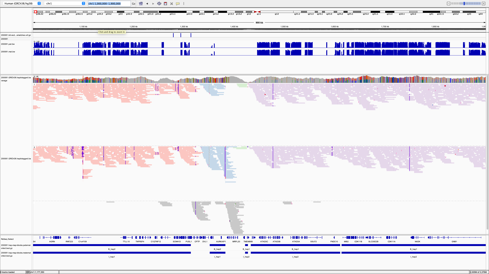
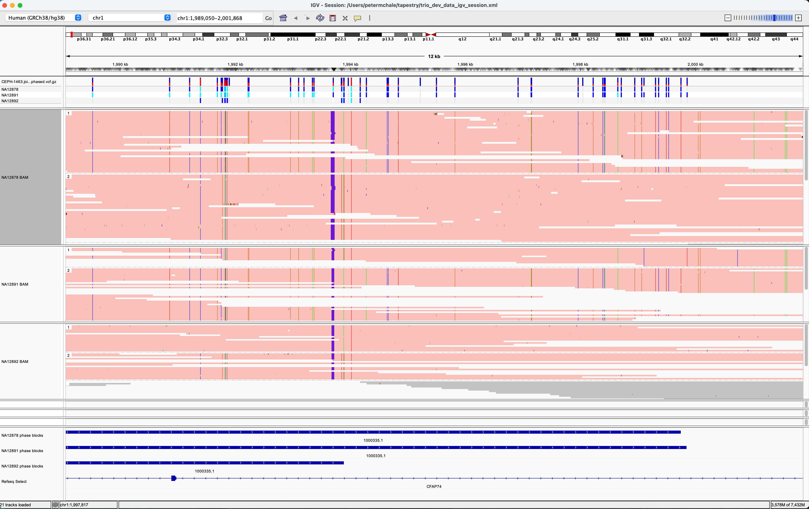
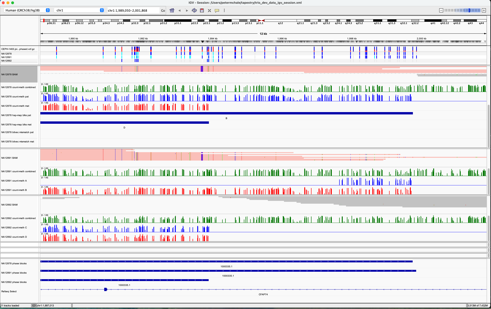
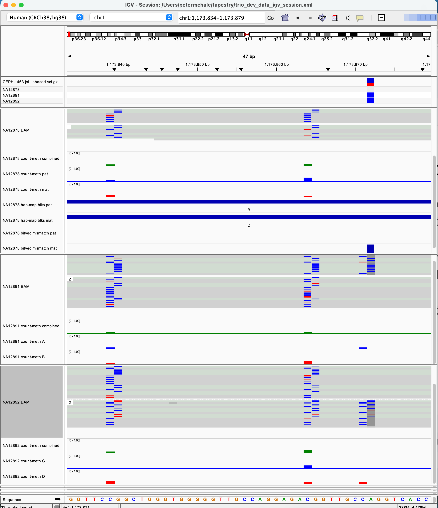

# Legacy shell workflows

Run commands from the repository root. These instructions describe the original
site-specific deployment; the [README](../README.md) is the entry point for the
shared-container Nextflow workflows.

### Dependencies

The shell workflows below assume the following command-line tools are in the
user's PATH:

* `bgzip`, `tabix`, `bcftools`
* `gtg-ped-map`, `gtg-concordance` (https://github.com/Platinum-Pedigree-Consortium/Platinum-Pedigree-Inheritance/blob/e12aca6b49ee7208952467db4a2a9e2f79b98efb/HAPLOTYPING.md)
* `hiphase` (https://github.com/PacificBiosciences/HiPhase)
* `aligned_bam_to_cpg_scores` (https://github.com/PacificBiosciences/pb-CpG-tools)

### Installation

Install the python dependencies:

```
/path/to/python3.11 -m venv .venv
source .venv/bin/activate

# https://github.com/brentp/cyvcf2?tab=readme-ov-file#github-building-htslib-and-cyvcf2-from-source
cd $HOME
git clone --recursive https://github.com/brentp/cyvcf2
cd cyvcf2
pip install -r requirements.txt
CYVCF2_HTSLIB_MODE=EXTERNAL python setup.py install

cd /path/to/tapestry
pip install -r requirements-dev.txt
```

Install `bedGraphToBigWig` into the virtual environment's bin directory:

```
# Choose the binary for your platform from the official UCSC downloads. Linux
# x86_64 example:
curl -O https://hgdownload.soe.ucsc.edu/admin/exe/linux.x86_64/bedGraphToBigWig
chmod +x bedGraphToBigWig
mv bedGraphToBigWig .venv/bin/
```

## Legacy pedigree shell workflow

1. Phase variants:
   - Phase variants using read-backed phasing with the `run-hiphase.sh` script.
   - Build an inheritance-based haplotype map and inheritance-phase variants using the `build-iht-based-haplotype-map-and-phase-variants.sh` script.
2. Use `aligned_bam_to_cpg_scores.sh` to generate count- and model-based methylation levels from the haplotagged BAM files produced in step 1.
3. Phase count- and model-based methylation data to founder haplotypes using the `phase_meth_to_founder_haps.sh` script, which uses the data produced in steps 1 and 2.
4. Use `expand_to_all_cpgs.sh` script to generalize tapestry's output to include all CpG sites in the reference and sample genome, and unphased count- and model-based methylation levels, where available. This step also uses heterozygous SNVs to flag CpG sites that are "allele-specific", i.e., exist in only one of the haplotypes in the sample in question. Uses output of steps 2 and 3.

### Step 3 of pedigree workflow: Phasing count- and model-based DNA methylation to founder haplotypes

The `phase_meth_to_founder_haps.sh` script calls a CL tool called `src/phase_meth_to_founder_haps.py`:

```
vcf_read_phased="${read_phased_dir}/${uid}.GRCh38.deepvariant.glnexus.phased.vcf.gz" # single-sample vcf from hiphase
tsv_read_phase_blocks="${read_phased_dir}/${uid}.GRCh38.hiphase.blocks.tsv" # single-sample tsv from hiphase
vcf_iht_phased="${iht_phased_dir}/CEPH1463.GRCh38.pass.sorted.vcf.gz" # joint-called multi-sample vcf from gtg-ped-map/gtg-concordance
txt_iht_blocks="${iht_phased_dir}/CEPH1463.GRCh38.iht.sorted.txt" # multi-sample iht blocks file from gtg-ped-map/gtg-concordance
bed_meth_count_hap1="${meth_count_read_phased_dir}/${uid}.GRCh38.haplotagged.hap1.bed.gz" # bed file of count-based methylation from aligned_bam_to_cpg_scores for hap1
bed_meth_count_hap2="${meth_count_read_phased_dir}/${uid}.GRCh38.haplotagged.hap2.bed.gz" # bed file of count-based methylation from aligned_bam_to_cpg_scores for hap2
bed_meth_model_hap1="${meth_model_read_phased_dir}/${uid}.GRCh38.haplotagged.hap1.bed.gz" # bed file of model-based methylation from aligned_bam_to_cpg_scores for hap1
bed_meth_model_hap2="${meth_model_read_phased_dir}/${uid}.GRCh38.haplotagged.hap2.bed.gz" # bed file of model-based methylation from aligned_bam_to_cpg_scores for hap2
regions="chr1,chr2,chr3,chr4,chr5,chr6,chr7,chr8,chr9,chr10,chr11,chr12,chr13,chr14,chr15,chr16,chr17,chr18,chr19,chr20,chr21,chr22"

nohup python src/phase_meth_to_founder_haps.py \
    --uid ${uid} \
    --vcf_read_phased ${vcf_read_phased} \
    --tsv_read_phase_blocks ${tsv_read_phase_blocks} \
    --vcf_iht_phased ${vcf_iht_phased} \
    --txt_iht_blocks ${txt_iht_blocks} \
    --bed_meth_count_hap1 ${bed_meth_count_hap1} \
    --bed_meth_count_hap2 ${bed_meth_count_hap2} \
    --bed_meth_model_hap1 ${bed_meth_model_hap1} \
    --bed_meth_model_hap2 ${bed_meth_model_hap2} \
    --regions ${regions} \
    --output_dir ${output_dir} \
    > ${output_dir}/${uid}.log 2>&1 &

```

The tool writes founder-phased methylation, haplotype maps, mismatch sites, and
BigWigs for visualization in IGV:



### Step 4 of pedigree workflow: Expanding the dataset to include all CpG sites in the reference and the sample genome, and to include unphased DNA methylation, and to flag CpGs as "allele-specific"

We would like to be aware of the existence of all CpG sites in the reference genome, irrespective of whether phased or unphased methylation levels are reported for those sites. Additionally, DNA methylation levels are computed at all CpG sites in the sample's haplotypes, even if those CpG sites are not in the reference genome (an example of a variant "creating" a CpG site in the sample). Conversely, CpG sites can be destroyed by mutation, and therefore a methylation level is not reported at that site on the corresponding haplotype. We call such CpG sites "allele-specific". Finally, this step of the workflow reports various QC statistics, e.g., the percentage of CpG sites (in reference and sample genomes, and on phasable chromosomes) at which count-based methylation is phased to at least one parental haplotype. See `https://github.com/quinlan-lab/tapestry/blob/main/src/expand_to_all_cpgs.200081.ipynb` for examples of all these things.

### Output format of pedigree workflow

See the [pedigree column definitions](../README.md#output-format-of-pedigree-workflow).

## Legacy trio shell workflow

### Crossover-aware trio haplotype maps

For a phased chromosome VCF, generate a WhatsHap block list for each trio
member and run the matcher in hap-map-only mode. If screening used a cutoff
other than 10,000 bp, pass the same `--crossover-distance-bp` to the matcher.

```bash
# Set chrom, kid, dad, and mom to the chromosome and sample IDs.
for sample in "$kid" "$dad" "$mom"; do
  .venv/bin/whatshap stats --sample "$sample" --block-list "$sample.blocks.tsv" \
    "$chrom.phased.vcf.gz"
done
PYTHONPATH=src:src/util .venv/bin/python src/phase_meth_to_parent_haps.py \
  --kid_id "$kid" --dad_id "$dad" --mom_id "$mom" \
  --vcf_pedmec_phased "$chrom.phased.vcf.gz" --crossovers-tsv "$chrom.crossovers.tsv" \
  --blocks_tsv_kid "$kid.blocks.tsv" --blocks_tsv_dad "$dad.blocks.tsv" \
  --blocks_tsv_mom "$mom.blocks.tsv" --output_dir hap-maps --skip-methylation
```

The matcher compares the child’s paternal and maternal alleles with the
corresponding parent’s alleles within each `FORMAT/PS` pair. A homozygous
child with no PS contributes its allele to the widest overlapping child
block. Each parent’s comparisons are split at its isolated crossover
brackets. Nearby brackets connect into clusters across both parents. The
entire span of each cluster, including intervening gaps, is excluded for
every parent with a call in that cluster. Both flanking markers are excluded
from each bracket or cluster. Each remaining segment with informative SNVs
gets its own haplotype label, concordance and mismatch sites. The script
writes separate paternal and maternal hap-map BEDs with tabix indexes and
mismatch sites in BED and indexed VCF formats.

### Shell workflow

1. Phase variants using pedMEC-based trio phasing with the `run-whatshap.sh` script.
2. Use `aligned_bam_to_cpg_scores.sh` to generate count- and model-based methylation levels from the haplotagged BAM files produced in step 1, for each trio member (kid, dad, and mom).
3. Phase count- and model-based methylation data in kid to parental haplotypes (A/B in dad, C/D in mom) using the `phase_meth_to_parent_haps.sh` script, which uses the data produced in steps 1 and 2.
4. Use `expand_to_all_cpgs.trio.sh` to generalize tapestry's output to include all CpG sites in the reference and sample genomes, unphased count- and model-based methylation levels (for all three trio members, where available), and unphased bigwig files for IGV visualization. This step also uses heterozygous SNVs to flag CpG sites that are "allele-specific" for each family member individually. Uses output of steps 2 and 3. See `https://github.com/quinlan-lab/tapestry/blob/main/src/expand_to_all_cpgs.trio.ipynb` for examples.

### Step 3 of trio workflow: Phasing count- and model-based DNA methylation in kid to parental haplotypes

WhatsHap's optional `phase --recombination-list` report records putative crossovers
and flanking parental haplotype states, but does not identify transmitted
haplotypes in blocks without reported crossovers. See the
[source evidence and upstream test](../docs/whatshap_recombination_evidence.md).

The `phase_meth_to_parent_haps.sh` script calls `src/phase_meth_to_parent_haps.py`, which phases methylation levels in the kid to the corresponding haplotypes in the parents (A/B in dad, C/D in mom), and creates files for IGV visualization, e.g.,





### Step 4 of trio workflow: Expanding the dataset to include all CpG sites, unphased methylation, and per-member allele-specific CpG labeling

This step mirrors step 4 of the pedigree-wise workflow but is adapted for a trio. The key differences are:

- **Unphased methylation for all three members**: count- and model-based unphased methylation levels are included for kid, dad, and mom (rather than just a single sample).
- **Per-member allele-specific labeling**: CpG sites are flagged as allele-specific independently for each family member (kid, dad, and mom), since a variant may be heterozygous in one member but homozygous in another.
- **Separate paternal and maternal mismatch proximity**: proximity to mismatch sites is computed separately for the paternal and maternal sides.
- **Bigwig files**: unphased methylation bigwig files are written for each trio member for IGV visualization.

Informative example of allele-specific methylation resulting from a SNP in the trio:



### Output format of trio workflow

See the [trio column definitions](../README.md#output-format-of-trio-workflow).

### Trio dev data

A small development dataset for the CEPH1463 trio can be used to test the trio workflow. The following files support this:

File | Description
:--- | :---
`trio_dev_data_config.sh` | Defines the genomic region (`DEV_REGION`) used by all other dev data scripts.
`trio_dev_data_create.sh` | Creates the dev dataset by subsetting the production VCF and BAM files to the dev region. Run on a machine with access to the production data: `./trio_dev_data_create.sh trio_dev_data`.
`trio_dev_data_get_ref.sh` | Downloads the reference FASTA for the dev region chromosome from UCSC. Only needs to be run once: `./trio_dev_data_get_ref.sh trio_dev_data`.

The checked-in trio fixture covers GRCh38 chr22:20,500,000–21,500,000.
The [WhatsHap crossover experiments](../analysis/crossover_experiments/README.md)
run locally on that fixture and link to the code and results for the slide
notes. For local fixture inspection in IGV, open the generated BEDs and
indexed phased VCFs directly.

The subsequent [trio model methylation analysis](../analysis/nextflow-trio-model/README.md)
records and reproduces the second deck's phase blocks, crossover-aware parental
maps, and child methylation figures. The [analysis index](../analysis/README.md)
maps both slide decks to their source and output directories.

The legacy methylation wrapper expects pb-CpG-tools v3.0.0 at a fixed CHPC
installation path. A portable workflow needs to supply that executable in its
runtime. PacBio publishes a Linux x86-64 build.

To run the trio workflow on the dev data, on CHPC:

```
# One-time setup: download the dev-region reference FASTA (see trio_dev_data_get_ref.sh above)
./trio_dev_data_get_ref.sh trio_dev_data

# Pipeline (pass --dev-dir trio_dev_data to each step):
./run-whatshap.sh --dev-dir trio_dev_data
./aligned_bam_to_cpg_scores.sh -t NA12879 NA12877 NA12878 --dev-dir trio_dev_data
./phase_meth_to_parent_haps.sh --dev-dir trio_dev_data
./expand_to_all_cpgs.trio.sh --dev-dir trio_dev_data
```

All output is written under `trio_dev_data/output/`.

### Open chr22 trio results on CHPC in IGV

Start the range server on the CHPC host that will be the SSH tunnel endpoint.
Give it the run's results directory containing `pedmec-phasing/` and
`dna-methylation/`:

```bash
.venv/bin/python serve_data_for_igv.py --data-dir /absolute/path/to/chr22-run/output
```

On your Mac, forward port 8000 to that same host:

```bash
ssh -N -L 127.0.0.1:8000:127.0.0.1:8000 hunnicutt
```

In IGV Desktop, use **File > Open Session** to open
[`trio_chr22_igv_session.xml`](../trio_chr22_igv_session.xml) from the local
checkout. It opens near the isolated paternal crossover and includes a saved
region for the distance-flagged cluster. It loads model methylation BigWigs
using the existing trio output filenames and inferred WhatsHap crossovers from
the quality-filtered experiment’s `crossover-experiments/quality/crossovers.bed`.
Keep indexes beside the corresponding tracks. For a different output layout,
update the resource paths and matching track IDs in the XML.

For remote pedigree data, the range server can still serve an explicit
directory. Start it on CHPC with
`.venv/bin/python serve_data_for_igv.py --data-dir /path/to/pedigree-data`,
then forward port 8000 with `ssh -L 8000:localhost:8000 <host>` and load the
track URLs in IGV.

## Remaining work

See [ROADMAP.md](../ROADMAP.md) for current release gates and planned work.

## Resources

- https://docs.google.com/document/d/1HGBhjqk4cqZaWIkh0GeAaBC_fcZYWRRnYO5cjiifKEY/edit?usp=sharing

### Prior art

Eberle et al. (2017) and Kronenberg et al. (2024) phase variants from inheritance vectors using the same approach as Fig 3, but neither computes the inheritance vectors with the gtg-ped-map approach: Eberle used Merlin, and Kronenberg used an HMM.

- Eberle et al. (2017): [paper](https://genome.cshlp.org/content/27/1/157.full.pdf), [supplement](https://genome.cshlp.org/content/suppl/2016/11/25/gr.210500.116.DC1/Supplementary_Information.pdf)
- Kronenberg et al. (2024): [preprint](https://www.biorxiv.org/content/10.1101/2024.10.02.616333v1.full.pdf)
